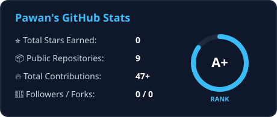
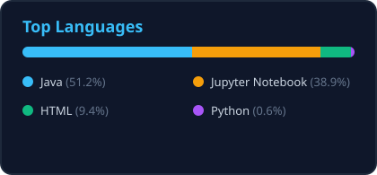
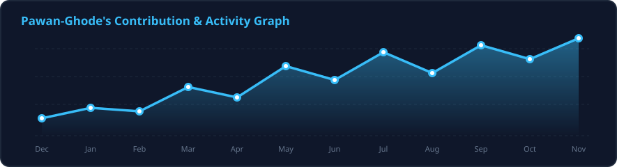

<!-- ==================== DYNAMIC HEADER BANNER ==================== -->
<div align="center">
  

  <!-- ==================== ANIMATED TYPING SVG ==================== -->
  <a href="https://github.com/Pawan-Ghode">
    
  </a>

  <br/>

  <!-- ==================== SOCIAL & CONTACT BADGES ==================== -->
  <p align="center">
    <a href="https://pawan-ghode.github.io/about_me/" target="_blank">
      
    </a>
    <a href="https://www.linkedin.com/in/pawan-ghode/" target="_blank">
      
    </a>
    <a href="mailto:pawanghode85@gmail.com">
      
    </a>
    <a href="https://github.com/Pawan-Ghode">
      
    </a>
  </p>
</div>

---

### 👨‍💻 Engineering Profile

```java
package dev.pawanghode.architecture;

public class BackendEngineer {
    private final String name = "Pawan Janardhan Ghode";
    private final String role = "Backend Developer (Java & Spring Boot)";
    private final String education = "B.Tech in Information Technology @ YCCE, Nagpur (CGPA: 7.90)";
    private final String location = "Nagpur, India";

    private final String[] coreCompetencies = {
        "Scalable RESTful APIs & Microservices Architecture",
        "High-Concurrency Locking, Caching (Redis) & ACID Transactions",
        "Asynchronous Event-Driven Pipelines (Apache Kafka)",
        "Database Query Optimization & Zero-Downtime Migrations"
    };

    public String getCurrentFocus() {
        return "Architecting fault-tolerant distributed systems and production-ready backends.";
    }
}
```

---

### 💼 Professional Experience

* **Trainee Advance ASE — Accenture** *(Jun 2026 – Sep 2026 | Nagpur, India)*
  * Engineered distributed cloud infrastructure configurations supporting scalable enterprise architectures.
  * Executed a high-load database migration simulation, monitoring transactional logs to guarantee **100% data consistency** with **zero downtime**.
  * Modeled and optimized backend data pipeline architectures to streamline high-concurrency enterprise workflows.

* **Core Java Intern — UniConverge Technologies Pvt. Ltd.** *(Mar 2026 – Apr 2026 | Remote)*
  * Engineered a secure **Banking Management System** in Core Java using modular OOP architecture for scalable transaction processing.
  * Refactored data validation and database interaction layers, cutting application execution errors by **40%** and accelerating debugging cycles.

---

### 🛠️ Technical Arsenal

<div align="center">

| Category | Technologies & Tools |
| :--- | :--- |
| **Languages** |    |
| **Backend & Security** |     |
| **Databases & Messaging** |     |
| **DevOps, Cloud & Testing** |       |

<br/>

<!-- Quick Visual Icons Bar -->


</div>

---

### 🚀 Featured Backend Architecture Projects

<table>
  <tr>
    <td width="50%" valign="top">
      <h3 align="center">💳 Fintech Payment Processing API</h3>
      <p align="center">
        <code>Spring Boot</code> • <code>MySQL</code> • <code>Apache Kafka</code> • <code>REST API</code>
      </p>
      <ul>
        <li><b>ACID-Compliant Engine:</b> Built a fault-tolerant payment gateway simulation enforcing strict transactional integrity across concurrent ledger updates.</li>
        <li><b>Event-Driven Decoupling:</b> Integrated <b>Apache Kafka</b> to asynchronously dispatch payment notifications and invoice generation without blocking core transaction threads.</li>
        <li><b>Idempotent Endpoints:</b> Engineered idempotency keys into REST APIs for safe network retries, eliminating duplicate fund deductions.</li>
      </ul>
    </td>
    <td width="50%" valign="top">
      <h3 align="center">🎟️ Scalable Movie Ticketing Backend</h3>
      <p align="center">
        <code>Java</code> • <code>Spring Boot</code> • <code>PostgreSQL</code> • <code>Redis</code> • <code>Docker</code>
      </p>
      <ul>
        <li><b>Concurrency Control:</b> Implemented <b>pessimistic and optimistic DB locking</b> to handle simultaneous seat reservations with zero double-bookings.</li>
        <li><b>60% Latency Reduction:</b> Deployed <b>Redis Caching</b> for high-read movie listings and theater layouts, significantly offloading PostgreSQL read traffic.</li>
        <li><b>Production Readiness:</b> Containerized microservices with <b>Docker</b> and secured endpoints using <b>Spring Security + JWT</b> stateless authentication.</li>
      </ul>
    </td>
  </tr>
</table>

---

### 🏆 Achievements & Research

* 🧠 **Algorithmic Problem Solving:** Solved **400+ DSA problems** on LeetCode and ranked in the **Top 10% globally** across multiple LeetCode Weekly Contests.
* 📄 **Published Research Author:** Co-authored and published a peer-reviewed paper on an **AI-Driven Posture Monitoring System**, combining computer vision pipelines with modular system architecture.
* ⚡ **Hackathons & Rapid Prototyping:** Active builder in **Devpost** and **HackerEarth** 48-hour weekend sprints, shipping production-ready backend services under tight deadlines.

---

### 📊 GitHub Analytics & Coding Activity

<div align="center">
  <!-- GitHub Stats & Top Languages (Generated via GitHub Actions in output branch) -->
  
  
</div>

<br/>

<div align="center">
  <!-- GitHub Streak Status Bar -->
  
</div>

<br/>

<div align="center">
  <!-- 100% Unbreakable GitHub Trophies Bar -->
  <table>
    <tr>
      <td align="center" width="140">
        <b>🏆 Java & Spring </b><br/>
        <br/>
        <sub>Backend Core</sub>
      </td>
      <td align="center" width="140">
        <b>🏆 LeetCode DSA </b><br/>
        <br/>
        <sub>400+ Solved</sub>
      </td>
      <td align="center" width="140">
        <b>🏆 Commits </b><br/>
        <br/>
        <sub>Active Coder</sub>
      </td>
      <td align="center" width="140">
        <b>🏆 Repositories </b><br/>
        <br/>
        <sub>Open Source</sub>
      </td>
      <td align="center" width="140">
        <b>🏆 Architecture </b><br/>
        <br/>
        <sub>Microservices</sub>
      </td>
      <td align="center" width="140">
        <b>🏆 Research </b><br/>
        <br/>
        <sub>Published Author</sub>
      </td>
    </tr>
  </table>
</div>

<br/>

<div align="center">
  <!-- Animated Contribution Snake -->
  <picture>
    <source media="(prefers-color-scheme: dark)" srcset="https://raw.githubusercontent.com/Pawan-Ghode/Pawan-Ghode/output/github-contribution-grid-snake-dark.svg" />
    <source media="(prefers-color-scheme: light)" srcset="https://raw.githubusercontent.com/Pawan-Ghode/Pawan-Ghode/output/github-contribution-grid-snake.svg" />
    
  </picture>
</div>

<br/>

<div align="center">
  <!-- Contribution Activity Graph (Generated via GitHub Actions in output branch) -->
  
</div>

---

<!-- ==================== FOOTER BANNER ==================== -->
<div align="center">
  <p><i>"Clean architecture, low latency, and zero-downtime deployments."</i></p>
  
</div>
