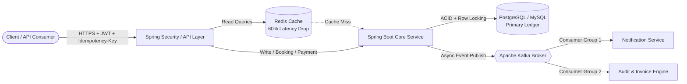

<!-- ==================== DYNAMIC ARCHITECTURAL HEADER ==================== -->
<div align="center">
  

  <!-- ==================== ANIMATED TYPING TERMINAL ==================== -->
  <a href="https://github.com/Pawan-Ghode">
    
  </a>

  <br/>

  <!-- ==================== QUICK NAVIGATION & CONTACT BAR ==================== -->
  <p align="center">
    <a href="https://pawan-ghode.github.io/about_me/" target="_blank">
      
    </a>
    &nbsp;
    <a href="https://www.linkedin.com/in/pawan-ghode/" target="_blank">
      
    </a>
    &nbsp;
    <a href="mailto:pawanghode85@gmail.com">
      
    </a>
    &nbsp;
    <a href="https://github.com/Pawan-Ghode">
      
    </a>
    &nbsp;
    
  </p>
</div>

<br/>
  <!-- ==================== ANIMATED TYPING TERMINAL ==================== -->
  <a href="https://github.com/Pawan-Ghode">
    
  </a>

  <br/>

  <!-- ==================== QUICK NAVIGATION & CONTACT BAR ==================== -->
  <p align="center">
    <a href="https://pawan-ghode.github.io/about_me/" target="_blank">
      
    </a>
    &nbsp;
    <a href="https://www.linkedin.com/in/pawan-ghode/" target="_blank">
      
    </a>
    &nbsp;
    <a href="mailto:pawanghode85@gmail.com">
      
    </a>
    &nbsp;
    <a href="https://github.com/Pawan-Ghode">
      
    </a>
    &nbsp;
    
  </p>
</div>

<br/>

<!-- ==================== 01 // SYSTEM SPECIFICATION ==================== -->
### `01 //` SYSTEM_SPECIFICATION

```java
package dev.pawanghode.architecture;

import org.springframework.stereotype.Service;
import java.util.List;

@Service
public final class BackendArchitectureProfile {

    public record EngineerSpec(
        String fullName,
        String specialization,
        String AlmaMater,
        String baseLocation
    ) {}

    public EngineerSpec getIdentity() {
        return new EngineerSpec(
            "Pawan Janardhan Ghode",
            "Backend Software Engineer — Java (11/17), Spring Boot & Distributed Systems",
            "B.Tech in Information Technology @ YCCE, Nagpur (CGPA: 7.90)",
            "Nagpur, India"
        );
    }

    public List<String> getArchitecturalPillars() {
        return List.of(
            "RESTful API Design, Idempotency & Stateless Security (JWT / OAuth2)",
            "High-Concurrency Control via Pessimistic/Optimistic DB Locking & ACID Guarantees",
            "Low-Latency Distributed Caching (Redis) & Event-Driven Brokers (Apache Kafka)",
            "Zero-Downtime Database Migrations, Query Tuning & Docker Containerization"
        );
    }
}
```

---

<!-- ==================== 02 // PRODUCTION EXPERIENCE ==================== -->
### `02 //` PRODUCTION_EXPERIENCE

<table>
  <tr>
    <td width="100%">
      <p>
        
        
      </p>
      <ul>
        <li><b>Cloud & Enterprise Infrastructure:</b> Engineered distributed cloud infrastructure configurations designed to sustain high-availability enterprise system architectures.</li>
        <li><b>Zero-Downtime Database Migration:</b> Executed high-load database migration simulations while auditing transactional logs to enforce <b>100% data consistency</b> with <b>zero downtime</b>.</li>
        <li><b>Data Pipeline Optimization:</b> Modeled and streamlined backend data pipeline architectures to handle high-concurrency enterprise workloads.</li>
      </ul>
      <hr/>
      <p>
        
        
      </p>
      <ul>
        <li><b>Modular Banking Core:</b> Architected a secure <b>Banking Management System</b> in Core Java utilizing strict OOP design patterns for scalable transaction processing.</li>
        <li><b>40% Error Reduction:</b> Refactored data validation and database interaction layers, reducing runtime execution exceptions by <b>40%</b> and accelerating debugging workflows.</li>
      </ul>
    </td>
  </tr>
</table>

---

<!-- ==================== 03 // TECHNICAL ARSENAL ==================== -->
### `03 //` TECHNICAL_STACK_&_INFRASTRUCTURE

<div align="center">

| Architectural Layer | Core Technologies & Production Tooling |
| :--- | :--- |
| **Core Languages** |    |
| **Backend & Security** |     |
| **Data Stores & Brokers** |     |
| **DevOps, Cloud & QA** |       |

<br/>


</div>

---

<!-- ==================== 04 // FEATURED SYSTEM ARCHITECTURES ==================== -->
### `04 //` FEATURED_SYSTEM_ARCHITECTURES

<table>
  <tr>
    <td width="50%" valign="top">
      <p align="center">
        
      </p>
      <p align="center">
        <code>Spring Boot</code> • <code>MySQL</code> • <code>Apache Kafka</code> • <code>REST API</code>
      </p>
      <ul>
        <li><b>ACID-Compliant Ledger Engine:</b> Engineered a fault-tolerant payment gateway simulation enforcing strict transactional isolation and atomicity across concurrent balance mutations.</li>
        <li><b>Event-Driven Decoupling:</b> Integrated <b>Apache Kafka</b> message brokers to asynchronously offload payment notifications and invoice generation without blocking core transaction threads.</li>
        <li><b>Idempotent REST Design:</b> Implemented unique idempotency keys across mutation endpoints to guarantee safe network retries and zero duplicate fund deductions.</li>
      </ul>
    </td>
    <td width="50%" valign="top">
      <p align="center">
        
      </p>
      <p align="center">
        <code>Java 17</code> • <code>Spring Boot</code> • <code>PostgreSQL</code> • <code>Redis</code> • <code>Docker</code>
      </p>
      <ul>
        <li><b>High-Concurrency Seat Locking:</b> Implemented <b>pessimistic and optimistic database locking</b> strategies to resolve race conditions during simultaneous seat bookings.</li>
        <li><b>60% Read Latency Reduction:</b> Deployed a distributed <b>Redis Cache</b> layer for high-frequency movie listings and venue layouts, drastically offloading primary PostgreSQL read IOPS.</li>
        <li><b>Containerized & Secured:</b> Packaged microservices via <b>Docker</b> for reproducible deployments and enforced stateless authentication using <b>Spring Security + JWT</b>.</li>
      </ul>
    </td>
  </tr>
</table>

<details>
  <summary><b>Click to Expand: High-Concurrency Backend Architecture Blueprint (Mermaid.js)</b></summary>
  <br/>


</details>

---

<!-- ==================== 05 // BENCHMARKS & RESEARCH ==================== -->
### `05 //` ENGINEERING_BENCHMARKS_&_RESEARCH

<div align="center">
  <table>
    <tr>
      <td align="center" width="16%">
        <sub><b>BACKEND CORE</b></sub><br/><br/>
        <br/>
        <sub>Java & Spring</sub>
      </td>
      <td align="center" width="16%">
        <sub><b>ALGORITHMS</b></sub><br/><br/>
        <br/>
        <sub>400+ LeetCode DSA</sub>
      </td>
      <td align="center" width="16%">
        <sub><b>CONCURRENCY</b></sub><br/><br/>
        <br/>
        <sub>Redis & DB Locking</sub>
      </td>
      <td align="center" width="16%">
        <sub><b>RELIABILITY</b></sub><br/><br/>
        <br/>
        <sub>Zero-Downtime DB</sub>
      </td>
      <td align="center" width="16%">
        <sub><b>PUBLICATION</b></sub><br/><br/>
        <br/>
        <sub>AI Posture Research</sub>
      </td>
      <td align="center" width="16%">
        <sub><b>PROTOTYPING</b></sub><br/><br/>
        <br/>
        <sub>Devpost / HackerEarth</sub>
      </td>
    </tr>
  </table>
</div>

* **Algorithmic Problem Solving:** Solved **400+ Data Structures & Algorithms problems** on LeetCode, consistently securing a **Top 10% global rank** in LeetCode Weekly Contests.
* **Published Academic Research:** Co-authored and published a peer-reviewed research paper on an **AI-Driven Posture Monitoring System**, integrating real-time computer vision pipelines with modular backend architecture.
* **Competitive Engineering Sprints:** Active participant in **Devpost** and **HackerEarth** 48-hour hackathons, designing and deploying fault-tolerant backend services under strict production deadlines.

---

<!-- ==================== 06 // TELEMETRY & CODING ACTIVITY ==================== -->
### `06 //` GITHUB_TELEMETRY_&_ACTIVITY_MATRIX

<div align="center">
  <!-- Self-Hosted GitHub Stats & Top Languages -->
  
  
</div>

<br/>

<div align="center">
  <!-- GitHub Streak Status Bar -->
  
</div>

<br/>

<div align="center">
  <!-- Animated Contribution Snake -->
  <picture>
    <source media="(prefers-color-scheme: dark)" srcset="https://raw.githubusercontent.com/Pawan-Ghode/Pawan-Ghode/output/github-contribution-grid-snake-dark.svg" />
    <source media="(prefers-color-scheme: light)" srcset="https://raw.githubusercontent.com/Pawan-Ghode/Pawan-Ghode/output/github-contribution-grid-snake.svg" />
    
  </picture>
</div>

<br/>

<div align="center">
  <!-- Self-Hosted Contribution Activity Graph -->
  
</div>

---

<!-- ==================== FOOTER BANNER ==================== -->
<div align="center">
  <code>[ SYSTEM_PHILOSOPHY :: "Clean architecture, low latency, and zero-downtime deployments." ]</code>
  
</div>
